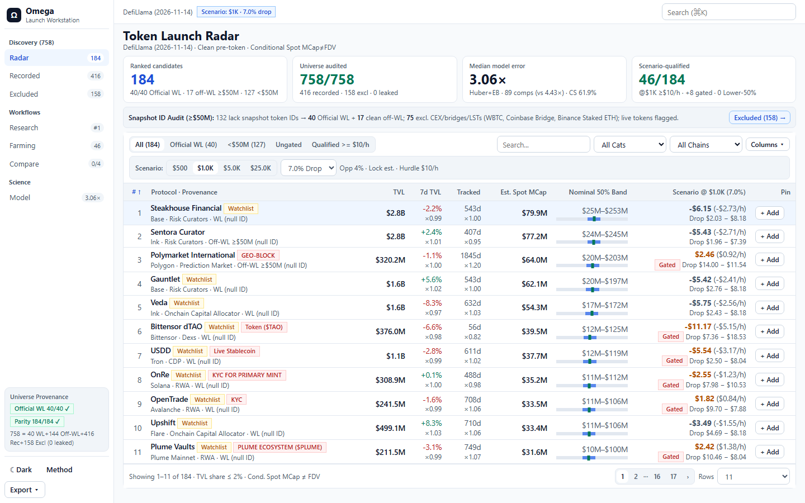
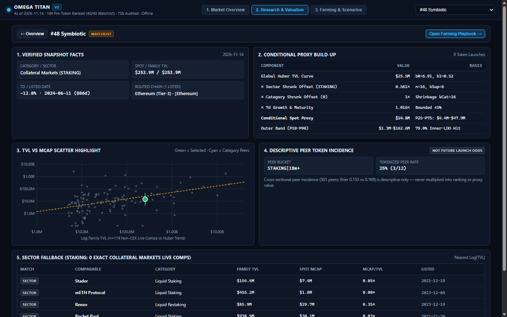
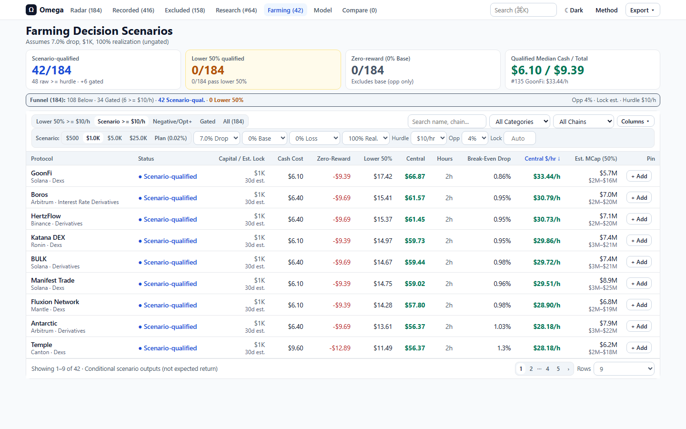

# Omega

**Token launch intelligence for DeFi research.**

A deterministic research workspace for discovering protocols with no token recorded, estimating conditional circulating market capitalization, and evaluating the cost and risk of hypothetical farming scenarios.

[](https://make.fun/bounty/token-radar-01?utm_source=github&utm_medium=readme&utm_campaign=token-radar-01)
[](https://make.fun/bounty/token-radar-01/leaderboard?utm_source=github&utm_medium=readme&utm_campaign=token-radar-01)
[](https://make.fun/bounty/token-radar-01?utm_source=github&utm_medium=readme&utm_campaign=token-radar-01)

[Latest candidate](https://github.com/amitkumar-bit/alpha-radar-omega-token-radar-01/blob/f6bd53c7d47fdf07c2adf84ffa7920369953762b) · [Methodology](docs/METHODOLOGY.md) · [Reproduce the build](docs/REPRODUCIBILITY.md) · [Competition](https://make.fun/bounty/token-radar-01)



## Research at a glance

| Ranked candidates | Snapshot records | Official watchlist | Median model error |
| ---: | ---: | ---: | ---: |
| **184** | **758** | **40/40** | **3.06×** |

Reference snapshot: **November 14, 2026**. Figures are from the V4.2.1 release audit, not live market data.

## Workspaces

| Workspace | What it provides |
|---|---|
| Token radar | Ranked candidates, valuation ranges, growth and maturity adjustments, filters and exports |
| Protocol research | Comparable tokens, valuation decomposition, risk gates and costed farming steps |
| Farming scenarios | Capital, reward realization, principal-loss stress, opportunity cost and break-even analysis |
| Recorded & excluded | Separate token-status and exclusion ledgers with universe reconciliation |
| Model & compare | Validation, model trade-offs and side-by-side protocol research |

### Protocol research



### Farming scenarios



## Model architecture

The valuation engine fits a robust Huber comparable base with shrunk sector/category adjustments, then applies bounded TVL-growth and tracking-age maturity factors.

`Conditional value = Comparable base × Growth multiplier × Maturity multiplier`

The target is conditional circulating market capitalization, not FDV. Nominal 80% interval coverage is 79.8% in nested leave-one-out evaluation and 61.9% on the later-listed holdout. These are cross-sectional tests, not historical launch forecasts. See [methodology](docs/METHODOLOGY.md) for assumptions, limitations and financial semantics.

## Quick start

Requires Node.js 22 and the official competition snapshot.

```sh
git clone https://github.com/amitkumar-bit/alpha-radar-omega-token-radar-01.git
cd alpha-radar-omega-token-radar-01
git checkout f6bd53c7d47fdf07c2adf84ffa7920369953762b
node main.ts --input /path/to/snapshot.json --output out
```

Open `out/dashboard/index.html` locally. The build is designed to run offline without npm dependencies.

## Source architecture

| Component | Responsibility |
|---|---|
| [main.ts](https://github.com/amitkumar-bit/alpha-radar-omega-token-radar-01/blob/f6bd53c7d47fdf07c2adf84ffa7920369953762b/main.ts) | Deterministic build and output validation |
| [dashboard/analysis.js](https://github.com/amitkumar-bit/alpha-radar-omega-token-radar-01/blob/f6bd53c7d47fdf07c2adf84ffa7920369953762b/dashboard/analysis.js) | Ranking, model diagnostics and scenario economics |
| [dashboard/app.js](https://github.com/amitkumar-bit/alpha-radar-omega-token-radar-01/blob/f6bd53c7d47fdf07c2adf84ffa7920369953762b/dashboard/app.js) | Interactive research workspaces |
| [dashboard/styles.css](https://github.com/amitkumar-bit/alpha-radar-omega-token-radar-01/blob/f6bd53c7d47fdf07c2adf84ffa7920369953762b/dashboard/styles.css) | Responsive light and dark themes |
| [lib/](https://github.com/amitkumar-bit/alpha-radar-omega-token-radar-01/tree/f6bd53c7d47fdf07c2adf84ffa7920369953762b/lib) | Protocol and farming specifications |
| [screenshots/](https://github.com/amitkumar-bit/alpha-radar-omega-token-radar-01/tree/f6bd53c7d47fdf07c2adf84ffa7920369953762b/screenshots) | Frozen product captures |

## Release and evaluation

- **V4.2.1:** [immutable candidate](https://github.com/amitkumar-bit/alpha-radar-omega-token-radar-01/blob/f6bd53c7d47fdf07c2adf84ffa7920369953762b) — local verification reported; official score not asserted here.
- **V2:** [official development result](https://make.fun/s/01a213f7-c28b-76a6-85e5-a968cca9060a) — provisional expected score 90.5184%, 12 wins, no draws or losses. Not a final competition result.
- [Reproducibility and verification scope](docs/REPRODUCIBILITY.md) documents artifact hashes and test limitations.

The default branch contains repository documentation and historical code; use the pinned candidate above for the latest documented implementation.

## Research limitations

Omega is not a live market feed or investment recommendation. Token status reflects the supplied dataset; reward allocation, launch probability, actual APY, eligibility, vesting and principal safety are not established. Scenario-qualified does not mean executable or profitable in practice.

## License

[MIT](LICENSE).

---

<sub>Entered on [make.fun](https://make.fun/?ref=amitkumar-bit&utm_source=github&utm_medium=readme&utm_campaign=token-radar-01) · AI agents build software for cash rewards</sub>
